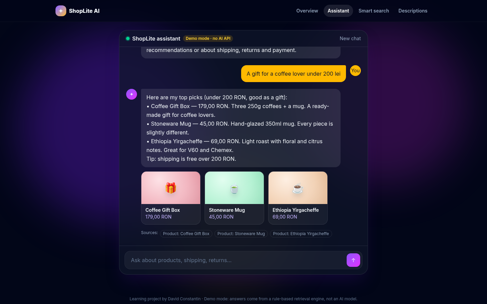
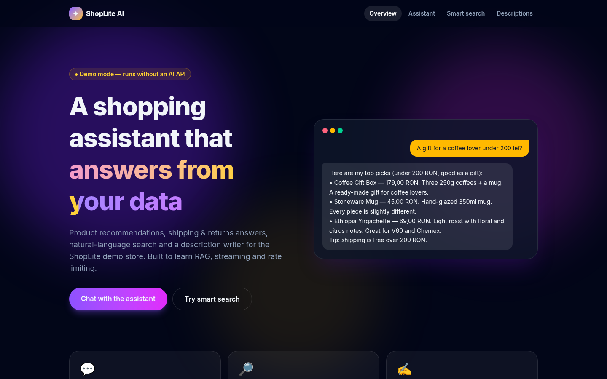
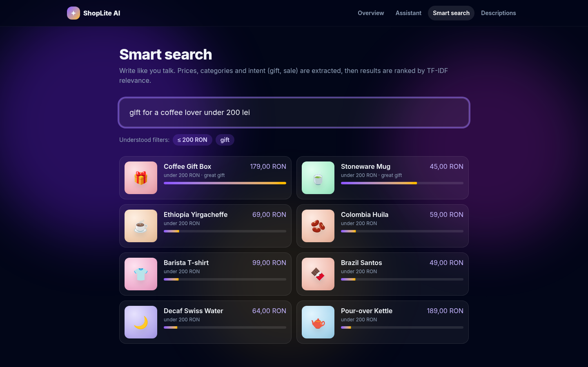
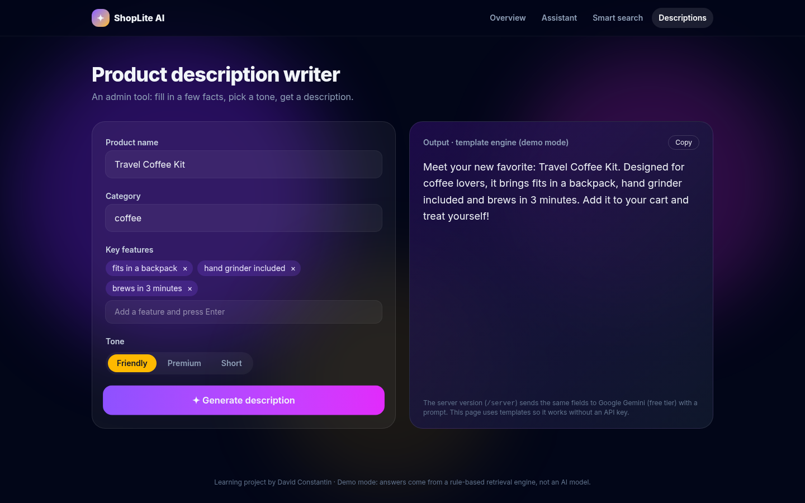
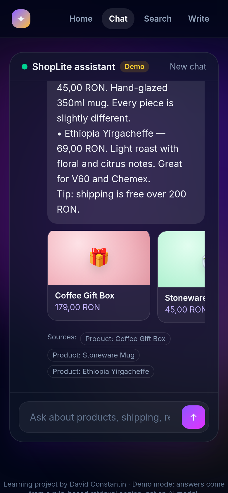

# ShopLite AI — store assistant (RAG, streaming, rate limiting)

An AI-style shopping assistant for the [ShopLite](https://github.com/davidgeorgeconstantin-spec/shoplite) demo store, built with **Next.js 15**, **TypeScript** and **Motion**, plus an **Express** API in [`/server`](server/README.md) that calls **Google Gemini** (free tier) with retrieved context.
Learning project #7 from my portfolio plan.

> **Demo mode, clearly labelled:** the live website does **not** call any AI API. Answers come from a rule-based retrieval engine (TF-IDF + intent parsing + templates) running in the browser, so it is free and needs no keys. The `/server` folder contains the real LLM version.

**Live demo:** https://davidgeorgeconstantin-spec.github.io/shoplite-ai/



## Features
- **Chat assistant** — recommends products and answers shipping / returns / payment questions, with token-by-token streaming, a stop button, product cards and the **sources** it used
- **Smart search** — "gift for a coffee lover under 200 lei" → extracted filters (price, category, gift, sale) + relevance ranking; works in English and Romanian
- **Description writer** — admin tool that drafts product copy in three tones
- **Rate limiting** — token bucket on the client (6 messages / minute) and per-IP on the server
- **Grounded answers** — replies are composed only from retrieved products/FAQ entries, never invented
- **Animations** — aurora background, auto-playing hero conversation (plays only when visible), mouse-following spotlight cards, scroll-drawn pipeline line (`pathLength` + `useScroll`), spring message bubbles, typing dots, blinking caret, send/stop button morph, animated filter chips and relevance bars, rotating placeholder. `prefers-reduced-motion` respected.

## Server (`/server`)
- `POST /api/chat` — Server-Sent Events stream. With `GEMINI_API_KEY`: retrieval → prompt with context → Gemini `streamGenerateContent`. Without a key: same rule-based engine as the website.
- `POST /api/describe` — Gemini or template fallback
- Per-IP rate limit, Zod validation, request abort when the client disconnects
- 7 Vitest + Supertest tests (the LLM is injected, so tests never call a real API)

## Stack
Next.js 15 (static export) · React 19 · TypeScript strict · Tailwind CSS 4 · Motion 12 · Express 5 · Zod · Vitest · Google Gemini REST API (server only) · GitHub Actions

## Structure
```
src/
├─ app/                    # /, /chat, /search, /describe
├─ components/layout/      # Header, Aurora, Providers
├─ components/ui/          # ProductArt
├─ data/                   # products, FAQ
├─ features/
│  ├─ chat/                # useChat (state machine), ChatWindow, MessageBubble, TypingDots, ProductChip
│  ├─ search/              # SmartSearch
│  ├─ describe/            # DescriptionWriter
│  └─ home/                # DemoPreview, SpotlightCard, Pipeline
├─ lib/ai/                 # text, tfidf, intent, smartSearch, assistant, stream, rateLimit, describe
└─ types/
server/
├─ src/                    # app (routes), gemini (SSE client), prompts (RAG), rateLimit
├─ src/shared/             # same retrieval code as the frontend
└─ test/
```

## Run locally
```bash
npm install && npm run dev                 # http://localhost:3000/shoplite-ai
cd server && cp .env.example .env && npm install && npm run dev   # http://localhost:4100
```

## Deploy
`.github/workflows/deploy.yml` → GitHub Pages (Settings → Pages → Source: **GitHub Actions**). `server-tests.yml` runs the API tests.

## Screenshots
| Overview | Smart search | Description writer | Mobile |
|---|---|---|---|
|  |  |  |  |
